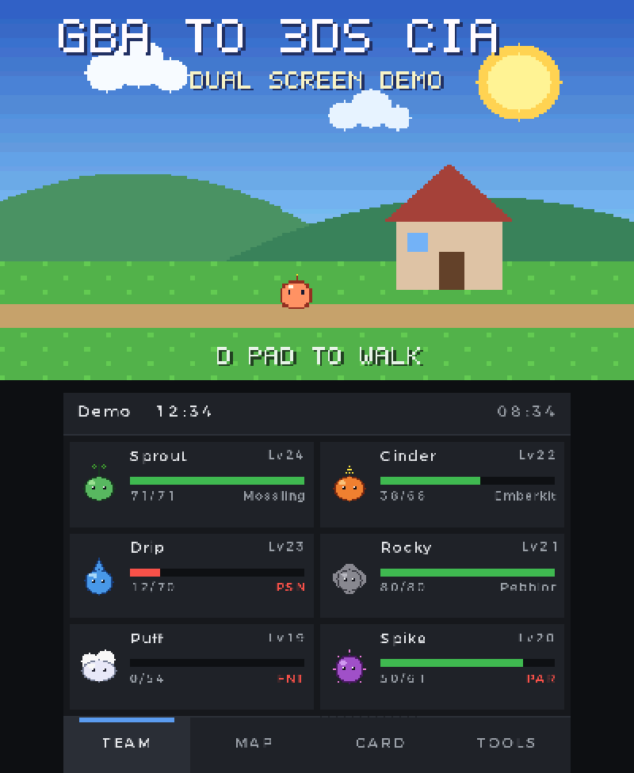
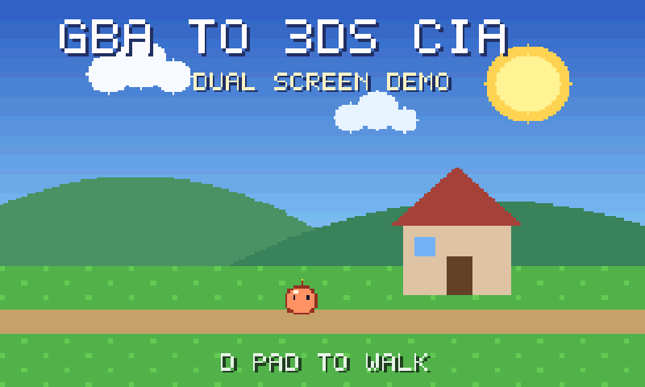
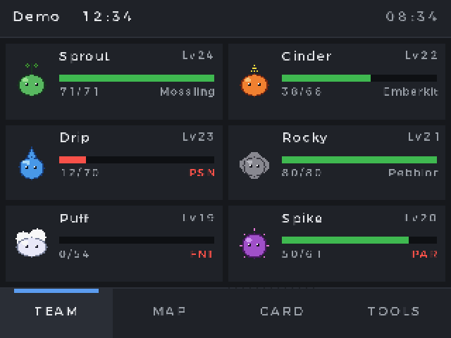
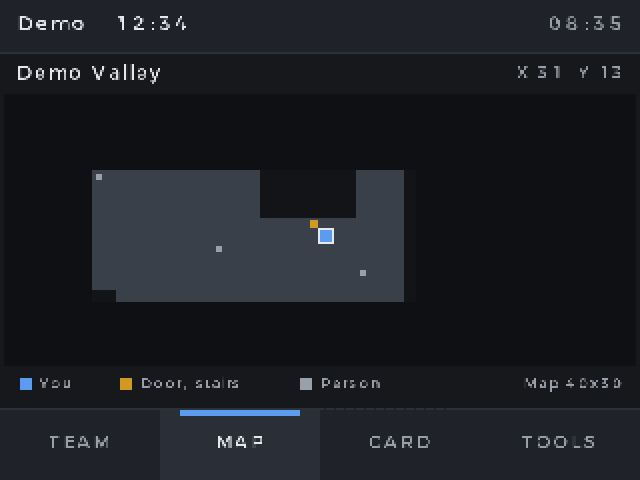
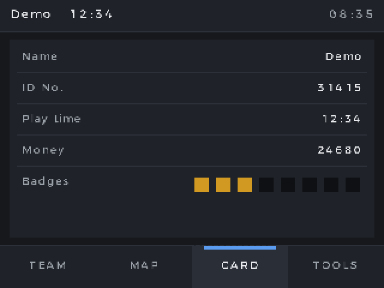
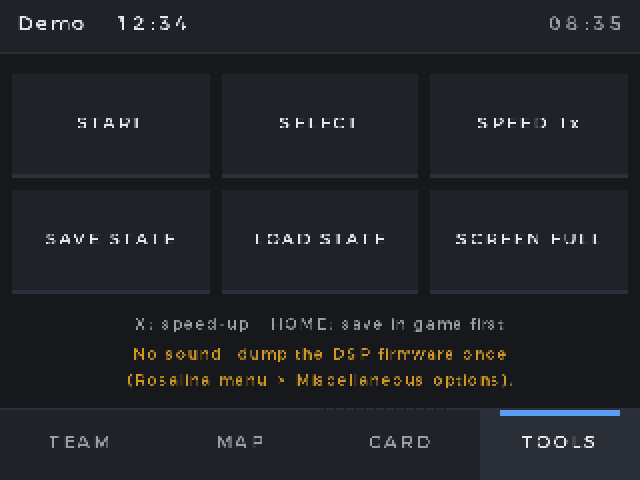

# gba-to-3ds-cia

Turn a Game Boy Advance ROM into an installable Nintendo 3DS title (`.cia`).
The game appears on the HOME Menu with its own icon and banner, and runs on
the GBA hardware built into every 3DS and 2DS (GBA Virtual Console, AGB_FIRM).

- **Web app:** <https://lxwiq.github.io/gba-to-3ds-cia/>. Everything runs in your
  browser (WebAssembly); your ROM is never uploaded.
- **Command line:** a single self-contained binary for macOS, Linux and Windows.
- **No external tools:** NCCH, ExeFS, RomFS, SMDH, banner (CBMD, CGFX, BCWAV),
  ticket, TMD and CIA are all written natively. No makerom, 3dstool, bannertool,
  Python or Docker.
- **ROM hacks:** applies IPS, UPS and BPS patches, with checksum verification
  of the base ROM (Pokemon Unbound, Emerald Rogue, Radical Red, and others).
- **Saves:** detects the save chip (EEPROM 4/64 Kbit, SRAM, Flash 64/128 KB) and
  the real-time clock, and converts emulator `.sav` files for import on the
  console.

This project is a rewrite of [vcoven](https://github.com/vedoot/vcoven), whose
injects install but never keep their saves. See [What was fixed](#what-was-fixed).

## Screenshots

Dual screen mode, running the built-in demo ROM (`assets/demo/gba2cia-demo.gba`,
original graphics made for this project) in the Azahar emulator. The game
fills the top screen; the bottom screen is a touch panel.

<p align="center"></p>

<p align="center"></p>

| TEAM | MAP |
|:---:|:---:|
|  |  |
| **CARD** | **TOOLS** |
|  |  |

Virtual Console mode runs on the console's GBA hardware, which no emulator
reproduces, so it has no screenshots here.

Requirements: a 3DS, 2DS, New 3DS or New 2DS XL running custom firmware
([Luma3DS](https://github.com/LumaTeam/Luma3DS)), and
[FBI](https://github.com/lifehackerhansol/FBI) to install the `.cia`.
No ROMs are included: use dumps of games you own.

## Quick start

### Web

1. Open the web app and choose your `.gba` file.
2. Optionally pick an icon, a banner image and a title.
3. Click **Build .cia**.
4. Copy the `.cia` to the SD card, open FBI, go to **SD**, select the file and
   choose **Install CIA**.

### Command line

```sh
gba2cia info game.gba
gba2cia build game.gba --title "My Game" --icon icon.png --banner banner.png
```

Every option has a sensible default: the title comes from the file name, the
save type and clock are detected, the icon and banner are generated, and the
title ID is derived from the game.

```text
gba2cia build <ROM> [options]
  --patch <FILE>         IPS, UPS or BPS patch applied first (ROM hacks)
  -o, --output <FILE>    output path (default: <ROM>.cia)
  -t, --title <TEXT>     HOME Menu name
  -p, --publisher <TEXT>
  --icon <IMAGE>         PNG, JPEG, GIF, BMP or WebP; cropped to a square
  --banner <IMAGE>       top screen banner, fitted into 256x128
  --banner-sound <WAV>   banner jingle, first 3 seconds
  --save <TYPE>          auto, none, eeprom4k, eeprom64k, sram, flash512k, flash1m
  --rtc <auto|on|off>    real-time clock (flash saves only)
  --colour <vivid|original>  colour curve and LCD ghosting
  --title-id <HEX16>     default: derived from the game, stable across rebuilds

gba2cia patch <ROM> <PATCH> -o <OUT>     apply a patch only
gba2cia save <SAV> [--rom <ROM> | --save <TYPE>] -o <OUT>   convert a save
```

Build from source with `cargo build --release -p gba2cia` (Rust 1.85 or newer).

## Pokemon Unbound

Unbound is distributed by its author, Skeli, as a patch, not as a ROM.

1. Download the official patch (`Pokemon Unbound Official.ups`, version 2.1.1.1)
   from the
   [official PokeCommunity thread](https://www.pokecommunity.com/threads/pok%C3%A9mon-unbound-completed.382178/).
2. You need a clean dump of **Pokemon FireRed (USA) version 1.0**, CRC32 `DD88761C`.
   Revision 1.1 (CRC32 `84EE4776`) does not work.
3. Build:

   ```sh
   gba2cia build firered.gba --patch "Pokemon Unbound Official.ups" --title "Pokemon Unbound"
   ```

   In the web app, load the FireRed ROM, then the patch; the page checks the
   CRC32 for you.

The result is a 32 MiB ROM with a 128 KB flash save and the real-time clock
enabled, which Unbound needs for day and night and for daily events. Both are
detected automatically: every game built on the FireRed engine gets the clock.

## Saves

### How GBA Virtual Console saves work

The save travels through three places:

1. When the game starts, AGB_FIRM loads the save from the title's save file
   on the SD card.
2. When you quit with **HOME** (or **POWER**), AGB_FIRM writes the save to a NAND
   partition (AGBSAVE) and restarts the console.
3. The HOME Menu checks that save and copies it into the title's save file.

Three consequences:

- **Always quit with HOME.** Forcing the console off, a crash or an empty
  battery loses the progress made since the last time you quit.
- **The save file has a fixed size, set when the title is installed:** two
  copies of a 0x200-byte header plus the save, and at least 0x30000 bytes. A
  Flash 128 KB game therefore needs 0x40400 bytes. If the size is wrong, the
  console silently drops the save. This was the vcoven bug.
- **The save is signed with keys unique to your console.** A save file cannot be
  put inside the `.cia` or written from a computer; it is imported on the console.

FBI shows error `C8A04555` when you browse the save data of any GBA Virtual
Console title. This is normal: the file is not a regular 3DS save archive.

### Importing an emulator save

1. Convert the save. This trims emulator extras (such as mGBA's 16-byte clock
   block) and sets the exact size for the save chip:

   ```sh
   gba2cia save "Pokemon Unbound.sav" --rom unbound.gba -o unbound.sav
   ```

   The web app has the same converter.
2. Install the `.cia`, start the game, save once in game, then quit with HOME.
3. Copy the converted `.sav` to the SD card.
4. Hold **START** while powering on to open GodMode9 (the HOME Menu must not
   start first).
5. In GodMode9, select the `.sav` file and press **Y** to copy it.
6. Open `[S:] SYSNAND VIRTUAL`, select `agbsave.bin`, choose **AGBSAVE options...**
   and then **Inject GBA VC save**, and confirm.
7. Restart normally and start the game.

[Checkpoint](https://github.com/BernardoGiordano/Checkpoint) 4.0 and newer can
also back up and restore GBA Virtual Console saves, once the game has saved
at least once. GodMode9 byte-swaps EEPROM saves itself; give it the save as
the emulator wrote it.

### Save types

| Type | Size | Typical games |
|------|------|---------------|
| EEPROM 4 Kbit | 512 B | small early games, Classic NES Series |
| EEPROM 64 Kbit | 8 KB | many later games, Zelda: The Minish Cap |
| SRAM / FRAM | 32 KB | Metroid Fusion, Metroid Zero Mission |
| Flash 512 Kbit | 64 KB | many third-party games |
| Flash 1 Mbit | 128 KB | Pokemon Ruby, Sapphire, Emerald, FireRed, LeafGreen and their hacks |

The save chip is detected from the save library string the Nintendo SDK
leaves in the ROM (`FLASH1M_V103`, `EEPROM_V124`, ...). A few known games
override this detection.

The EEPROM size is not stored in the ROM. It is guessed from the library
version: V121 and V124 mean 64 Kbit, the others 4 Kbit, the same heuristic as
open_agb_firm. If an EEPROM game does not save, rebuild it with the other
size (`--save eeprom4k` or `--save eeprom64k`).

## The screen

AGB_FIRM shows the game on the top screen, scaled to the full height
(360x240) with smoothing. Hold **START** or **SELECT** while the game starts
to get the sharp original 240x160 picture instead. The firmware turns the
bottom screen off; no Virtual Console title can draw on it.

Colours: by default the picture is shown as is, like an emulator
(`--colour vivid`). `--colour original` applies the dimmer colour curve and the
LCD ghosting of Nintendo's own Virtual Console titles. Some games use
flickering sprites that ghosting turns back into the transparency they had
on a real GBA.

### Dual screen mode (experimental)

`--mode dual` (or **Dual screen** in the web app) builds a different kind of
title: the gba2cia player, a 3DS program built on the mGBA emulator core
(`player/`), with the ROM bundled in it. It gives up AGB_FIRM's exact
hardware for a dual-screen layout.

- **Top screen:** the game fills it, at 400x240 (`--scale full`, the default),
  360x240 (`aspect`) or pixel for pixel (`native`). The size can be changed on
  the console.
- **Bottom screen:** a touch panel with four pages.
  - **TEAM:** the party, with icon, name, level, HP and status.
  - **MAP:** the location name and a plan of the area around the player, drawn
    from the map's collision data with doors, stairs and people. Only what the
    player has already seen on the top screen is shown, so the plan never
    spoils unexplored places.
  - **CARD:** name, ID, play time, money and badges.
  - **TOOLS:** START, SELECT, speed-up (1x, 2x, 4x, also on X), quick save and
    load state, and the screen size.

  TEAM, MAP and CARD work with Pokemon Ruby, Sapphire, Emerald, FireRed,
  LeafGreen and ROM hacks built on them, Pokemon Unbound included.
  TEAM and CARD use the save file as soon as the title starts.
- **Saves:** the save is a plain emulator `.sav` kept in
  `sdmc:/3ds/gba2cia/<title id>/game.sav`, with a backup of the previous one
  (`game.sav.bak`). On the first launch, a save from another emulator whose
  file name contains the game title is looked for on the SD card and copied
  in; the original is never changed. `--sav` bundles a starting save instead.
- **Clock:** the real-time clock follows the console clock.

It runs at full speed on New 3DS and New 2DS XL; older models may slow down
in demanding scenes. Sound needs the DSP firmware dump that every 3DS
homebrew needs (Rosalina menu, Miscellaneous options, Dump DSP firmware).

```sh
gba2cia build firered.gba --patch "Pokemon Unbound Official.ups" --mode dual
```

The player is tested in the Azahar emulator with a headless libretro runner
(`player/test`).

## Console notes

- **Every model works the same way:** 3DS, 3DS XL, 2DS, New 3DS, New 3DS XL and
  New 2DS XL all have the same GBA hardware. On a 2DS, the sleep switch stands in
  for closing the lid.
- **Sleep:** GBA Virtual Console titles do not enter sleep mode when the lid
  closes. Games keep running unless they have their own sleep feature.
- **Leaving the game:** press **HOME** (or POWER). The console restarts into the
  HOME Menu, and that restart is what commits the save.
- **Reinstalling:** installing over an existing title keeps its save file, and
  that file's size was fixed when the title was first installed. If you used
  another injector for the same game before, delete the old title and its save
  data first (FBI: **Titles**, select it, then **Delete Title** and **Delete Save
  Data**). Back up the save first if it matters.
- **Custom firmware is required:** the stock firmware refuses unsigned titles.
  Luma3DS patches the signature checks.
- **Title IDs:** every title gets an ID of the form `0004000000XXXX00`, with
  `XXXX` between `F000` and `FFFF`. That range is free of retail games. The low
  byte must be `00`, or the title fails to launch. The ID is derived from the
  game code and title. Rebuilding the same game therefore replaces the installed
  title and keeps its save, while two different games can be installed side by side.

## What was fixed

vcoven produced titles that install and boot, but:

- **Saves never persisted** (issues #9, #12, #15, #18, #19).
  - **Cause:** every title was installed with a 0x30000-byte save file. Flash
    128 KB games (the main Pokemon games and their hacks) need 0x40400 bytes, and the
    console drops a save of the wrong size.
  - **Fix:** the size now follows the save chip.
  - The FBI error `C8A04555` in those reports is unrelated; it appears for every
    GBA VC title.
- **Wrong save chip settings.**
  - Every EEPROM game was given the 64 Kbit chip, although most use 4 Kbit, and
    the two are addressed differently.
  - Flash 64 KB games were given an Atmel chip with a clock, a combination no
    official title uses.
  - The chip timing words were never changed with the save type.
  - All of this now follows libn3ds and official titles.
- **No Flash 128 KB option** (#3, #11). Flash 1 Mbit is the 128 KB chip; it is
  now named that way and detected.
- **Installation broke** because of external binaries and a Homebrew checksum
  error (#17). Everything is now built in.
- **Freezes at the Game Boy logo** (#16) with the Luma3DS GBA boot screen on.
  The BIOS checks the header checksum, which ROM hacks often leave wrong. It is
  now corrected. ROMs are also padded to a power of two, as a cartridge would read.
- **Banners were letterboxed onto black** (#7). Unused areas are now transparent.
  Whether the HOME Menu shows its theme behind them has not been confirmed.
- **"An error occurred" at launch** (#2). It most likely came from title IDs
  that break the launch rules. Title IDs are now validated.

This rewrite also adds the following:

- patching with checksum verification
- an EEPROM size guess from the SDK library version
- real-time clock detection
- region-free titles (vcoven's were locked to North America)
- correct header checksums
- reproducible builds
- a save converter
- an in-browser version that never uploads the ROM

## How it works

A `.cia` is a set of nested containers. For a GBA Virtual Console title:

```text
CIA
  certificate chain, ticket, TMD (content hash, save data size)
  content 0: NCCH (CXI)
    NCCH header      title ID, layout, SHA-256 of each region, NoCrypto flag
    extended header  title ID, jump ID, 192 KB save data, AGB_FIRM permissions
    ExeFS
      .code    GBA ROM + 0x360-byte footer read by AGB_FIRM
      banner   CBMD: LZ11-compressed CGFX quad with a 256x128 texture + BCWAV jingle
      icon     SMDH: titles in 16 languages, 24x24 and 48x48 icons, flags
      logo     boot logo
    RomFS            empty (unused by GBA titles)
  meta: dependency list and icon (shown by FBI)
```

The `.code` footer tells AGB_FIRM:

- the ROM size
- the save chip, with or without clock
- the button combination pressed when the lid closes
- the save chip timings
- the LCD ghosting
- the colour lookup table

Its layout:

```text
ROM | config block (0x324) | 12 bytes padding | section table (2 x 16) | ".CAA" header (16)
```

The crate layout:

| Path | Purpose |
|------|---------|
| `crates/core` | library: ROM inspection, patches, saves, every 3DS format, build pipeline |
| `crates/cli` | the `gba2cia` command |
| `crates/wasm` | WebAssembly bindings for the web app |
| `web` | the web app (static files, no build step besides the WebAssembly module) |
| `player` | the dual screen player (C, libctru, citro2d, mGBA core; `player/build.sh` rebuilds it in Docker) |
| `player/demo` | the demo ROM: an original scene plus a fictional party, trainer and map, to show and test the player without a commercial game |

Each build parses its own output again and verifies every hash before it is
written, the same checks the console runs at install and launch.

## Roadmap

- Dual-screen mode: bag and Pokedex pages, testing on more consoles.
- Animated banners.

## Credits

The file formats come from [3dbrew](https://www.3dbrew.org) and from the source
of makerom and ctrtool (3DSGuy, jakcron), 3dstool (dnasdw), bannertool
(Steveice10), GodMode9 (d0k3), open_agb_firm (profi200) and vcoven
(Vedant Mehta). The banner model template comes from bannertool (MIT). See
[NOTICE.md](NOTICE.md).

## License

MIT. See [LICENSE](LICENSE).
